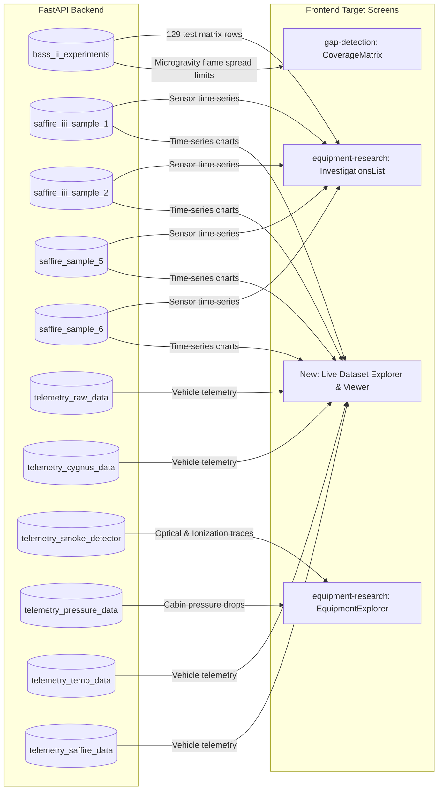
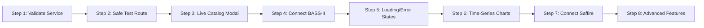

# NASA FLAME Frontend Codebase & API Integration Audit
**Comprehensive Technical Report, Architecture Analysis, and FastAPI Integration Roadmap**

---

- **Project:** NASA FLAME (Spacecraft Fire Safety Intelligence Dashboard)
- **Target Codebase:** `frontend` (`d:\My Projects\Nasa Space App Challange\NASAChallenge-2026-FLAME\frontend`)
- **Backend Service:** FastAPI running on `http://127.0.0.1:8000`
- **Auditor Role:** Senior React Architect, Frontend Codebase Auditor, and API Integration Engineer
- **Audit Date:** November 2026
- **Audit Scope:** 100% Read-Only Codebase Inspection (54 files audited across all directories)
- **Status:** Complete & Fully Verified

---

## 1. Executive Summary

The NASA FLAME frontend application is a purpose-built, high-density scientific research intelligence platform designed for exploring NASA microgravity combustion experiments (including BASS, Saffire, FLEX, ACME, and SAME). The application synthesizes flight measurements, identifies research gaps for exploration environments (such as Artemis lunar habitats and Moon-to-Mars transit vehicles), maps microgravity combustion physics to spacecraft fire safety equipment, and bridges space science with terrestrial fire protection challenges.

### Core Technology Stack & Verifiable Package Versions

Based on the verified contents of `package.json` and `package-lock.json`:

| Layer | Technology | Declared Version | Resolved / Installed Version |
| :--- | :--- | :--- | :--- |
| **UI Framework** | React | `^19.3.1` | `19.3.1` |
| **DOM Renderer** | React DOM | `^19.3.1` | `19.3.1` |
| **Bundler & Dev Server** | Vite | `^8.3.6` | `8.3.7` |
| **Styling Framework** | Tailwind CSS | `^4.3.5` | `4.3.5` |
| **Tailwind Vite Plugin**| `@tailwindcss/vite` | `^4.3.5` | `4.3.5` |
| **React Vite Plugin** | `@vitejs/plugin-react` | `^6.1.2` | `6.1.2` |
| **Linter** | Oxlint | `^1.90.0` | `1.93.0` |
| **Type Definitions** | `@types/react`, `@types/react-dom` | `^19.3.0` | `19.3.0` |
| **Language** | JavaScript (ESM, JSX) | ECMAScript 2023+ | Native V8 / Modern Browser |

### Architectural Findings

1. **Architecture Model:** Feature-based modular monolithic Single Page Application (SPA). The codebase is cleanly partitioned into domain features (`landing`, `gap-detection`, `equipment-research`, `earth-applications`), layout shells (`Header`, `Footer`, `MenuDrawer`), and shared primitives (`Button`).
2. **Routing Model:** Fully client-side **state-driven tab switching** managed via React's `useState('home')` in `src/app/App.jsx`. There is **no URL routing library** (no `react-router` or `react-router-dom`). The browser URL remains invariant at `/`.
3. **Styling & Design System:** Tailwind CSS v4 utilizing the modern `@import "tailwindcss";` syntax in `src/app/styles/index.css`. The design adheres to NASA dark-mode scientific aesthetics (`bg-slate-950`, `text-slate-100`, glassmorphism backdrop blur `glass-panel`, orange and cyan accent badges, JetBrains Mono font for technical telemetry).
4. **Component Libraries:** Zero external UI component libraries (no Radix UI, Headless UI, Material UI, Shadcn, or Lucide React). All interactive controls, modals, tabs, icons (inline SVGs), and layout containers are custom-coded React components.
5. **Data Flow & State Management:** In-memory synchronous static data. All domain knowledge, matrix cells, statistics, and technical references reside in `src/data/psiData.js` and `src/lib/constants.js`. Components consume this data through standard JavaScript imports. There is no global state store (no Redux, Zustand, MobX, or React Context).
6. **Backend Connectivity Status:** The frontend currently makes **zero network requests** during regular execution. An API service (`src/services/flameApi.js`) and a test component (`src/components/ApiConnectionTest.jsx`) were authored on disk, but they are **completely orphaned from the React rendering tree**. As a result, the user continues to see the original dashboard rather than the API test.

---

## 2. Complete Frontend Folder Structure

The frontend repository consists of 54 tracked files (excluding `node_modules` and `.git`). Below is the complete structural map:

```
frontend/
├── .env.local                                      # Local environment variables (VITE_API_BASE_URL)
├── .gitignore                                      # Git ignore rules for node_modules, dist, .env
├── .oxlintrc.json                                  # Oxlint static analysis configuration
├── index.html                                      # Single-page HTML shell with Google Fonts & root div
├── package.json                                    # Project metadata, dependencies & scripts
├── package-lock.json                               # Deterministic dependency tree lockfile
├── README.md                                       # Vite + Oxlint baseline documentation
├── vite.config.js                                  # Vite bundler configuration (React + Tailwind v4)
├── public/
│   ├── favicon.svg                                 # Browser favicon (NASA FLAME flame emblem)
│   └── icons.svg                                   # SVG spritesheet definitions
└── src/
    ├── main.jsx                                    # React application DOM mount entry point
    ├── app/
    │   ├── App.jsx                                 # Top-level application component & tab controller
    │   └── styles/
    │       └── index.css                           # Global styles, Tailwind imports, custom variables
    ├── assets/
    │   ├── hero.png                                # Static banner graphic asset
    │   ├── react.svg                               # Default React vector graphic
    │   └── vite.svg                                # Default Vite vector graphic
    ├── components/
    │   ├── ApiConnectionTest.jsx                   # [ORPHANED] Prototype API verification component
    │   ├── common/
    │   │   └── Button.jsx                          # Reusable button component with variant/size props
    │   └── layout/
    │       ├── Header.jsx                          # Top persistent navbar, brand logo, mobile drawer toggle
    │       ├── Footer.jsx                          # Bottom status bar, PSI links, view selectors
    │       └── MenuDrawer.jsx                      # Slide-out modal drawer with platform guide & PSI primer
    ├── data/
    │   └── psiData.js                              # Comprehensive NASA PSI static dataset (835 lines)
    ├── features/
    │   ├── landing/                                # Feature Module 0: Home / Landing Experience
    │   │   ├── index.jsx                           # Feature export barrel & container
    │   │   ├── components/
    │   │   │   ├── FlameHeroEffect.jsx             # Canvas container & physics mode selector
    │   │   │   ├── MissionBadge.jsx                # "Artemis & Moon-to-Mars Fire Safety Data" pill
    │   │   │   ├── PillarCard.jsx                  # Modular card with expand/collapse details
    │   │   │   ├── SearchBar.jsx                   # Natural language SI search simulation
    │   │   │   └── SuggestedQueries.jsx            # Quick query click pills
    │   │   ├── hooks/
    │   │   │   └── useFlameSimulation.js           # 248-line HTML5 Canvas particle physics engine
    │   │   └── sections/
    │   │       ├── HeroSection.jsx                 # Top hero layout with simulation & query input
    │   │       └── PillarsSection.jsx              # 3-pillar feature navigation grid
    │   ├── gap-detection/                          # Feature Module 1: Research Gap Detection
    │   │   ├── index.jsx                           # Feature container & state coordinator
    │   │   └── components/
    │   │       ├── CoverageMatrix.jsx              # 4x4 Gravity vs Oxygen heatmap matrix
    │   │       ├── CoverageOverview.jsx            # Quantitative metrics & PSI evidence distribution
    │   │       ├── GapDetailModal.jsx              # Deep-dive research gap inspection dialog
    │   │       ├── IdentifiedGaps.jsx              # Priority gap cards with filter pills
    │   │       ├── InterpretationSection.jsx       # Epistemic guidelines & Artemis fire safety context
    │   │       └── TopicSearch.jsx                 # Multi-dimensional parameter filter facets
    │   ├── equipment-research/                     # Feature Module 2: Fire-Safety Equipment Research
    │   │   ├── index.jsx                           # Feature container & category state
    │   │   └── components/
    │   │       ├── CategorySelector.jsx            # 5-domain category switcher tabs
    │   │       ├── EngineeringInsights.jsx         # 3-tier epistemic breakdown (Fact vs Design vs Rec)
    │   │       ├── EquipmentExplorer.jsx           # 5-subsystem flight hardware technical callouts
    │   │       ├── InvestigationsList.jsx          # Detailed NASA flight experiment spec cards
    │   │       ├── RelevanceFlow.jsx               # 4-step Research-to-Hardware visual pipeline
    │   │       └── SourcesEvidenceRepo.jsx         # PSI repository citations and flight limits
    │   └── earth-applications/                     # Feature Module 3: Terrestrial Technology Transfer
    │       ├── index.jsx                           # Feature container & evidence filter state
    │       └── components/
    │           ├── ApplicationEvidenceBadges.jsx   # 3-tier evidence classification filter
    │           ├── BenefitsLimitations.jsx         # Benefits vs physical scaling limitations
    │           ├── EarthCategoryNav.jsx            # 5 terrestrial application domain selectors
    │           ├── EarthFindingsList.jsx           # Empirical flight findings spec cards
    │           ├── EarthProblemExplorer.jsx        # Terrestrial hazard deep-dive explorer
    │           ├── RelatedEarthResearch.jsx        # NIST, UL FSRI, and journal external citations
    │           └── ResearchConnectionBridge.jsx    # 5-node space-to-earth transfer pipeline
    ├── lib/
    │   └── constants.js                            # Navigation items, suggested queries, SI insights
    └── services/
        └── flameApi.js                             # [ORPHANED] Fetch client targeting FastAPI endpoints
```

### Folder Roles & Architectural Intent

- `src/app/`: Application orchestrator layer. Contains global styles and the master `App.jsx` layout container that holds top-level tab state (`activeTab`) and toast notifications.
- `src/components/layout/`: Shared layout scaffolding (`Header`, `Footer`, `MenuDrawer`) that wraps every screen.
- `src/components/common/`: Primitive shared UI atoms. Currently holds `Button.jsx`.
- `src/features/`: Domain-driven module folders containing their own components, sections, and hooks. Each feature is self-contained with its own sub-barrel export.
- `src/data/`: Static domain knowledge repository (`psiData.js`). Houses domain matrices, statistics, research gaps, equipment data, and transfer bridges.
- `src/lib/`: Shared utility constants, navigation link definitions, and query response heuristics.
- `src/services/`: External I/O and networking layer. Houses `flameApi.js`.

---

## 3. Application Entry Points

### 1. `package.json`
Specifies standard Vite script entry points:
- `"dev": "vite"` — Starts the Vite development server (default port 5173).
- `"build": "vite build"` — Bundles production assets using Rollup.
- `"preview": "vite preview"` — Previews the production build locally.
- `"lint": "oxlint"` — Runs fast Rust-based Oxlint against the codebase.

### 2. `index.html`
The HTML document root located at the project root:
- Preconnects and loads Google Fonts: **Inter** (weights 300, 400, 500, 600, 700) and **JetBrains Mono** (weights 400, 500, 600).
- Sets body styling: `class="bg-slate-950 text-slate-100 antialiased selection:bg-orange-500/20 selection:text-orange-200 min-h-screen"`.
- Declares `<div id="root"></div>`.
- Loads the module entry script: `<script type="module" src="/src/main.jsx"></script>`.

### 3. `src/main.jsx`
The JavaScript bootstrap entry point:
- Imports React's `StrictMode` and `createRoot` from `'react-dom/client'`.
- Imports global CSS: `'./app/styles/index.css'`.
- Imports top-level component: `App` from `'./app/App.jsx'`.
- Mounts `<App />` into `document.getElementById('root')`.

### 4. `src/app/styles/index.css`
The global CSS foundation:
- Imports Tailwind CSS v4 via `@import "tailwindcss";`.
- Configures CSS custom properties under `@layer base`:
  - `--background`: `#020617` (Slate 950)
  - `--foreground`: `#f8fafc` (Slate 50)
  - `--card`: `#0b1329` (Custom deep space navy)
  - `--primary`: `#f97316` (Orange 500)
  - `--accent`: `#38bdf8` (Sky 400)
- Defines typography standards (`font-sans` maps to Inter, `font-mono` to JetBrains Mono).
- Defines utility classes `.animate-pulse-slow` and `.glass-panel` (backdrop-filter blur with subtle slate borders).

### Complete Startup & Rendering Sequence

```
1. Browser loads index.html
   └── Loads Google Fonts (Inter, JetBrains Mono)
   └── Executes <script type="module" src="/src/main.jsx">
2. main.jsx executes
   └── Imports index.css (initializes Tailwind CSS v4 design tokens)
   └── Calls createRoot(document.getElementById('root')).render(<StrictMode><App /></StrictMode>)
3. App.jsx executes
   └── Initializes state:
         activeTab = 'home'
         isMenuOpen = false
         toastMessage = null
   └── Renders Layout Structure:
         ├── Fixed Background Starfield Texture (radial-gradient grid)
         ├── Atmospheric Light Glow (blur-140px sky-500 radial orb)
         ├── <Header activeTab='home' ... />
         ├── <div className="flex-1 my-4">
         │     └── {activeTab === 'home' && <LandingPage ... />}
         ├── <Footer activeTab='home' ... />
         └── <MenuDrawer isOpen={false} ... />
4. LandingPage executes
   └── Renders <HeroSection />:
         ├── <MissionBadge /> ("Artemis & Moon-to-Mars Fire Safety Data")
         ├── <FlameHeroEffect /> -> activates useFlameSimulation hook
         │     └── requestAnimationFrame loop starts rendering canvas fire particles
         ├── Main headline: "Fire behaves differently in space..."
         ├── <SearchBar /> with natural language query parsing
         └── <SuggestedQueries />
   └── Renders <PillarsSection />:
         └── Maps PILLARS_DATA to 3 interactive <PillarCard /> components
```

---

## 4. Routing and Navigation

### Route Structure (State-Driven Virtual Navigation)

The application does not use URL path routing or the browser History API. All views are conditionally rendered based on the string state variable `activeTab` declared in `src/app/App.jsx`:

| Tab Key (`activeTab`) | Component Rendered | Component File Path | Trigger / Link Location |
| :--- | :--- | :--- | :--- |
| `'home'` (Default) | `<LandingPage />` | `src/features/landing/index.jsx` | Header logo, Header "Home" nav link, Footer "Home" link, MenuDrawer "Home" |
| `'gap-detection'` | `<ResearchGapDetection />` | `src/features/gap-detection/index.jsx` | Header "Research Gap Detection", Header "Open Dashboard" button, Hero CTA button, Pillar 1 Card, Footer link, MenuDrawer |
| `'equipment-research'` | `<EquipmentResearch />` | `src/features/equipment-research/index.jsx` | Header "Fire-Safety Equipment Research", Pillar 2 Card, Footer link, MenuDrawer |
| `'earth-applications'` | `<EarthApplications />` | `src/features/earth-applications/index.jsx` | Header "Earth Applications", Pillar 3 Card, Footer link, MenuDrawer |
| Special: `'menu'` | `<MenuDrawer />` (Modal) | `src/components/layout/MenuDrawer.jsx` | Header "Menu" nav item (opens slide-out drawer) |

### Navigation Fallback Behavior

In `src/app/App.jsx`:
```jsx
<div className="flex-1 my-4">
  {activeTab === 'home' && <LandingPage ... />}
  {activeTab === 'gap-detection' && <ResearchGapDetection />}
  {activeTab === 'equipment-research' && <EquipmentResearch />}
  {activeTab === 'earth-applications' && <EarthApplications />}
</div>
```
**Fallback vulnerability:** If `activeTab` is assigned any unrecognized string, none of the conditional branches evaluate to `true`. The container renders completely empty (`null`), showing only the Header and Footer with no 404 message or recovery prompt.

### Safest Location for Temporary API Connectivity Testing

To safely verify connectivity with the FastAPI backend without altering or breaking the existing dashboard views, there are three safe options:

#### Recommended Strategy: Dedicated Non-Destructive Virtual Tab (`'api-test'`)
- Add `{ id: 'api-test', label: 'API Diagnostics' }` to `NAV_LINKS` in `src/lib/constants.js`.
- Add a conditional branch in `src/app/App.jsx`:
  ```jsx
  {activeTab === 'api-test' && <ApiConnectionTest />}
  ```
- **Why this is safest:**
  - Leaves `'home'`, `'gap-detection'`, `'equipment-research'`, and `'earth-applications'` 100% untouched.
  - Gives the developer full-page real estate to inspect dataset counts, health status, and live JSON records.
  - Can be switched to and from instantly via the standard navigation bar.
  - Zero regression risk to existing features.

#### Alternative Strategy: Developer Section in `MenuDrawer.jsx`
- Place `<ApiConnectionTest />` inside the existing slide-out drawer (`src/components/layout/MenuDrawer.jsx`).
- **Advantage:** Completely hidden from the primary desktop header navigation. Accessible only when clicking "Menu".

---

## 5. All Existing Pages and Features

### Screen 1: Home / Landing Page
- **Primary Component:** `LandingPage` (`src/features/landing/index.jsx`).
- **Child Components:** `HeroSection`, `PillarsSection`, `MissionBadge`, `FlameHeroEffect`, `SearchBar`, `SuggestedQueries`, `PillarCard`.
- **Purpose:** Primary scientific landing experience introducing NASA microgravity combustion research, comparing 0g diffusion flames against 1g buoyant flames, providing an AI-style synthesis query bar, and offering launch points into the 3 analytical modules.
- **Key UI Elements & Visualizations:**
  - *HTML5 Canvas Flame Simulator (`FlameHeroEffect.jsx` & `useFlameSimulation.js`):* Renders an interactive 160-particle blackbody thermal simulation. Users can toggle between **Microgravity (0g Diffusion)** (spherical cool blue flame with isotropic diffusion) and **Earth (1g Buoyant)** (flickering convective teardrop flame with buoyant acceleration and ember sparks).
  - *Natural Language SI Query Bar (`SearchBar.jsx`):* Allows users to input scientific queries.
  - *Suggested Query Pills (`SuggestedQueries.jsx`):* Four one-click scientific questions (BASS Material Limits, Lunar 34% O₂ Hazard, FLEX Extinction, SAME Smoke Dynamics).
  - *Instant Synthesis Card:* Displays synthesized answers with confidence scores (e.g., 97.2%).
  - *3 Exploration Pillar Cards (`PillarsSection.jsx`):* Technical overview cards with expandable technical details and direct navigation links.
- **Data Source & Authenticity:** **100% Static Mock Data.**
  - `SAMPLE_SI_INSIGHTS` in `src/lib/constants.js` provides hardcoded responses matched via simple lowercase keyword matching (`bass`, `lunar`, `flex`) after a simulated `setTimeout` of 280ms.
- **State Management:**
  - `useFlameSimulation`: Canvas ref, mode state (`'microgravity'` | `'buoyant'`), particle lifecycle loops via `requestAnimationFrame`.
  - `SearchBar`: `query`, `prevActiveQuery`, `siResult`, and `isAnalyzing` states.
  - `PillarCard`: `expanded` boolean state for collapsible technical details.

---

### Screen 2: Research Gap Detection
- **Primary Component:** `ResearchGapDetection` (`src/features/gap-detection/index.jsx`).
- **Child Components:** `TopicSearch`, `CoverageOverview`, `CoverageMatrix`, `IdentifiedGaps`, `GapDetailModal`, `InterpretationSection`.
- **Purpose:** Identifies which microgravity and partial-gravity combustion conditions have been empirically investigated in NASA PSI flight missions, which have limited short-duration drop-tower data, and which represent unverified frontiers for Artemis lunar habitats and Mars transit vehicles.
- **Key UI Elements & Visualizations:**
  - *Parameter Filter Controls (`TopicSearch.jsx`):* Search bar and 5 dimension dropdown selectors:
    1. Gravity (Normal 1g, Micro ~0g, Partial Lunar 0.16g, Partial Mars 0.38g)
    2. Oxygen (Low <18%, Normal 21%, Elevated 28–34%, High >34%)
    3. Pressure (Hypobaric 56–70 kPa, Standard 101.3 kPa, Hyperbaric >105 kPa)
    4. Fuel (Solid Fabrics, Thick Solids, Liquid Droplets, Gaseous Fuels)
    5. Airflow (Quiescent 0 cm/s, Low Forced 0.5–5 cm/s, High Forced >10 cm/s)
  - *Coverage Overview Banner (`CoverageOverview.jsx`):* 4 metric cards:
    1. Flight Investigations: `38` datasets
    2. Usable Sensor Records: `214` time-series
    3. 1g Ground Baselines: `96` controls
    4. Evidence Distribution Bar: `48%` Available, `34%` Limited, `18%` Gaps
  - *Conditions Studied vs Unrepresented Lists:* Split comparison checklist highlighting well-characterized regimes versus critical unexplored exploration conditions.
  - *Research Coverage Heatmap Matrix (`CoverageMatrix.jsx`):* A 4x4 matrix plotting Gravity regimes against Oxygen levels. Each cell displays status (`heavy`, `moderate`, `limited`, `gap`), number of investigations, and usable series. Clicking a cell updates an interactive inspection panel with primary archive citations and an inspection button for critical gaps.
  - *Identified Research Gaps Cards (`IdentifiedGaps.jsx`):* Cards covering high-priority safety gaps:
    1. Solid Material Flammability in Lunar Partial Gravity (0.16g) at 34% O₂ / 10.2 psi
    2. Low-Temperature "Cool Flame" Persistence & Suppression Reignition Limits
    3. Aerosol Agglomeration Dynamics & Sub-Micron Smoke Detector Degradation in Microgravity
    4. Critical Quenching Airflow Thresholds for Thin vs Thick Polymers During Emergency Depressurization
  - *Modal Deep-Dive Inspector (`GapDetailModal.jsx`):* Comprehensive dialog displaying target exploration environment, available vs missing flight measurements, exploration criticality, and peer-reviewed citations with external DOI links.
  - *Epistemic Interpretation Panel (`InterpretationSection.jsx`):* Explicit guidelines separating raw empirical flight data from theoretical CFD extrapolations and ground drop-tower analogs.
- **Data Source & Authenticity:** **100% Static Mock Data.**
  - Consumes `PSI_STATISTICS`, `MATRIX_GRAVITY_AXIS`, `MATRIX_OXYGEN_AXIS`, `MATRIX_CELLS`, `IDENTIFIED_RESEARCH_GAPS`, and `RESEARCH_DIMENSIONS` from `src/data/psiData.js`.
- **State Management:**
  - `filters` object (`gravity`, `oxygen`, `pressure`, `fuel`, `airflow`).
  - `selectedGap` object for triggering the modal inspector.
  - `selectedCellKey` for matrix heatmap cell inspection.
  - `selectedArea` filter tab in identified gaps.

---

### Screen 3: Fire-Safety Equipment Research
- **Primary Component:** `EquipmentResearch` (`src/features/equipment-research/index.jsx`).
- **Child Components:** `CategorySelector`, `InvestigationsList`, `RelevanceFlow`, `EquipmentExplorer`, `EngineeringInsights`, `SourcesEvidenceRepo`.
- **Purpose:** Bridges fundamental microgravity combustion physics (SAME, FLEX, BASS, Saffire) with flight hardware design, selection, calibration, and evaluation for spacecraft fire safety systems.
- **Key UI Elements & Visualizations:**
  - *Category Selector Tabs (`CategorySelector.jsx`):* 5 interactive domain buttons:
    1. Fire Detection (smoke, aerosols, gas transport)
    2. Fire Suppression (extinguishing agents, inert gas, cool flames)
    3. Fire-Resistant Materials (flammability limits, LOI, ignition thresholds)
    4. Fire Behaviour & Ventilation (airflow velocity, oxygen flux, quenching limits)
    5. Fire-Safety Systems (monitoring, post-fire scrubbers, standards)
  - *NASA Investigations Spec Cards (`InvestigationsList.jsx`):* Dynamic list of investigations matching the selected category. Displays objective, fuel/material tested, experimental conditions, archived sensor types, empirical scientific findings, and expandable provenance specs.
  - *Research-to-Hardware Relevance Pipeline (`RelevanceFlow.jsx`):* An interactive 4-step horizontal flowchart:
    `[1. Scientific Research] ➔ [2. Observed Finding] ➔ [3. Operational Safety Problem] ➔ [4. Flight Equipment Application]`.
    Includes a 3-case selector (Smoke Detectors, Fire Extinguishers, Emergency Ventilation).
  - *Spacecraft Equipment Explorer (`EquipmentExplorer.jsx`):* Tabbed interface covering 5 core flight subsystems:
    1. Spacecraft Smoke Detectors
    2. Portable Fire Extinguishers & Suppression Systems
    3. Fire-Resistant Polymers & Thermal Barriers
    4. Emergency Ventilation Dampers & Airflow Controls
    5. Multi-Gas Combustion Product Analyzers
    Displays primary function, operational problems, microgravity sensitivities, NASA flight findings, and remaining engineering questions.
  - *3-Tier Epistemic Breakdown (`EngineeringInsights.jsx`):* Rigid 3-tier comparative columns:
    - Tier 1: Observed Empirical Finding (backed by raw flight sensors).
    - Tier 2: Engineering Implication (systems engineering design translation).
    - Tier 3: Forward Recommendation (unvalidated forward hypotheses).
    Includes explicit warning callouts on physical constraints and experimental limitations.
  - *Sources & Evidence Repository (`SourcesEvidenceRepo.jsx`):* Technical catalog listing verified flight missions, peer-reviewed citations, measurement types, and direct links to `psi.nasa.gov`.
- **Data Source & Authenticity:** **100% Static Mock Data.**
  - Consumes `FIRE_SAFETY_CATEGORIES`, `INVESTIGATIONS_BY_CATEGORY`, `RELEVANCE_FLOW_EXAMPLES`, `SPACECRAFT_EQUIPMENT_DATA`, `THREE_TIER_INSIGHTS`, and sources array from `src/data/psiData.js`.
- **State Management:**
  - `activeCategory` state (`'detection'` | `'suppression'` | `'materials'` | `'ventilation'` | `'systems'`).
  - `expandedId` accordion state in `InvestigationsList`.
  - `activePipelineIndex` in `RelevanceFlow`.
  - `selectedEquipId` in `EquipmentExplorer`.
  - `selectedInsightId` in `EngineeringInsights`.
  - `activeTab` filter in `SourcesEvidenceRepo`.

---

### Screen 4: Earth Applications
- **Primary Component:** `EarthApplications` (`src/features/earth-applications/index.jsx`).
- **Child Components:** `EarthCategoryNav`, `ApplicationEvidenceBadges`, `ResearchConnectionBridge`, `EarthProblemExplorer`, `EarthFindingsList`, `RelatedEarthResearch`, `BenefitsLimitations`.
- **Purpose:** Investigates how buoyancy-decoupled combustion science obtained in microgravity can be responsibly translated to terrestrial industrial hazard mitigation, wildfire smoldering models, building ventilation safety, and Halon-replacement suppression technologies.
- **Key UI Elements & Visualizations:**
  - *Earth Application Domain Nav (`EarthCategoryNav.jsx`):* 5 categories:
    1. Industrial Fire Safety (chemical processing, reactors, cleanrooms)
    2. Wildfire Research (deep smoldering peat/duff, low-wind spread)
    3. Building Fire Safety (airtight high-rises, subway tunnels, HVAC ducts)
    4. Protective Equipment (firefighter turnout gear, Nomex pyrolysis)
    5. Fire Suppression Technology (water mist, clean green gas blends)
  - *Application Evidence Classification Standards (`ApplicationEvidenceBadges.jsx`):* Interactive filter for 3 validation levels:
    - Level 1: Scientific Relevance (fundamental physical similarity).
    - Level 2: Potential Application (sound engineering scaling hypothesis).
    - Level 3: Demonstrated Application (empirically validated in NIST FDS or NASA Spinoff).
  - *Connection Bridge Pipeline (`ResearchConnectionBridge.jsx`):* 5-node visual transfer pipeline:
    `[NASA Experiment] ➔ [Scientific Finding] ➔ [Earth Fire Problem] ➔ [Earth Application] ➔ [Physical Limitations]`.
    Includes a 5-case bridge selector.
  - *Earth Problem Explorer (`EarthProblemExplorer.jsx`):* 5 terrestrial hazard cards explaining why Earth science needs space data, listing matching NASA studies, and highlighting scaling limitations.
  - *NASA Research Findings List (`EarthFindingsList.jsx`):* Expandable empirical flight cards for ACME, FLEX, BASS-II, and Saffire detailing measurements and terrestrial relevance.
  - *Related Earth Research References (`RelatedEarthResearch.jsx`):* Technical reference catalog citing NIST Special Publication 1018-1 (FDS 6), Combustion and Flame journal, NASA Spinoff 2021, and UL FSRI technical reports.
  - *Benefits & Physical Limitations Analysis (`BenefitsLimitations.jsx`):* Side-by-side comparison of benefits (decoupling physics, CFD benchmark verification) versus physical Earth constraints (1g buoyancy acceleration, atmospheric differences, scale & geometry effects) with a mandatory scientific claim guardrail banner.
- **Data Source & Authenticity:** **100% Static Mock Data.**
  - Consumes `EARTH_CATEGORIES`, `RESEARCH_CONNECTION_BRIDGES`, `EARTH_PROBLEMS`, `RELATED_EARTH_RESEARCH`, and `EARTH_BENEFITS_LIMITATIONS` from `src/data/psiData.js`.
- **State Management:**
  - `activeCategory` state (`'industrial'` | `'wildfire'` | `'building'` | `'protective'` | `'suppression-tech'`).
  - `selectedEvidenceLevel` filter state (`'all'` | `'1'` | `'2'` | `'3'`).
  - `selectedBridgeId` state in `ResearchConnectionBridge`.
  - `selectedProblemId` in `EarthProblemExplorer`.
  - `expandedId` in `EarthFindingsList`.

---

## 6. Component Architecture

### Component Hierarchy & Parent-Child Tree

```mermaid
graph TD
  Main[src/main.jsx] --> App[src/app/App.jsx]
  App --> Header[src/components/layout/Header.jsx]
  App --> Footer[src/components/layout/Footer.jsx]
  App --> MenuDrawer[src/components/layout/MenuDrawer.jsx]
  
  App -. activeTab === 'home' .-> Landing[src/features/landing/index.jsx]
  Landing --> HeroSec[sections/HeroSection.jsx]
  HeroSec --> MBadge[components/MissionBadge.jsx]
  HeroSec --> FlameHero[components/FlameHeroEffect.jsx]
  FlameHero -. uses .-> FlameHook[hooks/useFlameSimulation.js]
  HeroSec --> SBar[components/SearchBar.jsx]
  HeroSec --> SQueries[components/SuggestedQueries.jsx]
  Landing --> PillarsSec[sections/PillarsSection.jsx]
  PillarsSec --> PCard[components/PillarCard.jsx]

  App -. activeTab === 'gap-detection' .-> GapDet[src/features/gap-detection/index.jsx]
  GapDet --> TSearch[components/TopicSearch.jsx]
  GapDet --> CovOver[components/CoverageOverview.jsx]
  GapDet --> CovMat[components/CoverageMatrix.jsx]
  GapDet --> IdGaps[components/IdentifiedGaps.jsx]
  GapDet --> Interp[components/InterpretationSection.jsx]
  GapDet --> GapModal[components/GapDetailModal.jsx]

  App -. activeTab === 'equipment-research' .-> EquipRes[src/features/equipment-research/index.jsx]
  EquipRes --> CatSel[components/CategorySelector.jsx]
  EquipRes --> InvList[components/InvestigationsList.jsx]
  EquipRes --> RelFlow[components/RelevanceFlow.jsx]
  EquipRes --> EquipExp[components/EquipmentExplorer.jsx]
  EquipRes --> EngIns[components/EngineeringInsights.jsx]
  EquipRes --> SrcRepo[components/SourcesEvidenceRepo.jsx]

  App -. activeTab === 'earth-applications' .-> EarthApp[src/features/earth-applications/index.jsx]
  EarthApp --> EarthNav[components/EarthCategoryNav.jsx]
  EarthApp --> EvBadges[components/ApplicationEvidenceBadges.jsx]
  EarthApp --> Bridge[components/ResearchConnectionBridge.jsx]
  EarthApp --> ProbExp[components/EarthProblemExplorer.jsx]
  EarthApp --> FindList[components/EarthFindingsList.jsx]
  EarthApp --> RelRes[components/RelatedEarthResearch.jsx]
  EarthApp --> BenLim[components/BenefitsLimitations.jsx]

  Header --> Button[src/components/common/Button.jsx]
  
  Orphan1[src/services/flameApi.js] -. imported by .-> Orphan2[src/components/ApiConnectionTest.jsx]
  classDef orphan fill:#ef4444,stroke:#b91c1c,color:#fff;
  class Orphan1,Orphan2 orphan;
```



### Design Patterns & Shared Conventions
1. **Lifting State Up via Callback Props:** Child feature components communicate state changes to parent containers exclusively through callback props (e.g. `onSelectTab(tabId)`, `onOpenDashboard()`, `onFilterChange(dim, val)`).
2. **Prop Drilling of Tab Selectors:** `onSelectTab` is passed through multiple component levels (App ➔ Header / Footer / MenuDrawer / LandingPage ➔ PillarsSection ➔ PillarCard) to enable cross-module navigation.
3. **Controlled Tab & Accordion Switchers:** Component state stores the active string key (e.g. `activeCategory`, `selectedProblemId`, `expandedId`), allowing only one section or panel to expand at a time.
4. **Clean UI Atoms:** `Button.jsx` provides consistent typography and transition styling through `variant` (`primary`, `secondary`, `outline`, `ghost`, `accent`) and `size` (`sm`, `md`, `lg`) props.
5. **Epistemic Classification System:** Standardized styling conventions across features to clearly distinguish between:
   - *Empirical Flight Measurements:* Emerald badges (`bg-emerald-950/60 text-emerald-300 border-emerald-800`).
   - *Limited Drop Tower / Analog Baselines:* Sky & Amber badges (`text-sky-400`, `text-amber-400`).
   - *Critical Unexplored Gaps:* Rose badges (`bg-rose-950/60 text-rose-300 border-rose-800 animate-pulse`).

---

## 7. Existing Data Flow

### Current Static Data Movement

All data flowing through the active application is static, client-side, and synchronous.

```mermaid
flowchart TD
    subgraph Data Layer
        PSI[src/data/psiData.js]
        CONST[src/lib/constants.js]
    end

    subgraph State Layer (In-Memory React State)
        AppState[App.jsx State: activeTab]
        GapState[gap-detection State: filters, selectedGap]
        EquipState[equipment-research State: activeCategory, expandedId]
        EarthState[earth-applications State: activeCategory, selectedEvidenceLevel]
        SearchState[SearchBar State: query, isAnalyzing]
    end

    subgraph Presentation Components
        V1[LandingPage & FlameHeroEffect]
        V2[ResearchGapDetection & CoverageMatrix]
        V3[EquipmentResearch & InvestigationsList]
        V4[EarthApplications & ResearchConnectionBridge]
    end

    CONST -->|NAV_LINKS, PILLARS_DATA| AppState
    CONST -->|SAMPLE_SI_INSIGHTS| SearchState
    SearchState -->|siResult| V1
    
    PSI -->|MATRIX_CELLS, IDENTIFIED_RESEARCH_GAPS| GapState
    GapState --> V2
    
    PSI -->|INVESTIGATIONS_BY_CATEGORY, SPACECRAFT_EQUIPMENT_DATA| EquipState
    EquipState --> V3
    
    PSI -->|RESEARCH_CONNECTION_BRIDGES, EARTH_PROBLEMS| EarthState
    EarthState --> V4
```

### Mock Data Dependency Audit

Every single view in the active frontend currently depends on mock or hardcoded static data:
- **Landing Page:** Depends on hardcoded string maps in `src/lib/constants.js`. The search feature simulates an API response by running a 280ms timer and performing substring checks.
- **Gap Detection:** The 4x4 matrix, the cell contents, the statistics counters (38 flight datasets, 214 sensor series), and the identified gap records are imported directly from `psiData.js`.
- **Equipment Research:** The list of investigations, the 4-step pipeline text, the 5 equipment records, and the 3-tier insights are static objects in `psiData.js`.
- **Earth Applications:** The 5 transfer bridges, 5 earth problem cards, and NIST references are static objects in `psiData.js`.

**No dynamic fetch calls, Axios requests, WebSockets, or browser storage APIs (`localStorage`/`sessionStorage`) are utilized in the active application tree.**

---

## 8. Existing API Integration — Critical Investigation

A critical audit requirement was to investigate the API integration modules, determine their relationship with the running application, and explain why the original UI continues to display instead of the API test.

### File Verification Matrix

| Target File | Status on Disk | Size | Lines | Imported By |
| :--- | :--- | :--- | :--- | :--- |
| `src/services/flameApi.js` | **EXISTS** | 809 bytes | 35 lines | `src/components/ApiConnectionTest.jsx` **ONLY** |
| `src/components/ApiConnectionTest.jsx` | **EXISTS** | 1,024 bytes | 41 lines | **NONE (Completely unimported)** |
| `.env.local` | **EXISTS** | 39 bytes | 1 line | Loaded by Vite at runtime |

### Detailed Findings

#### 1. Is `flameApi.js` imported anywhere?
- `flameApi.js` is imported on line 2 of `src/components/ApiConnectionTest.jsx`:
  ```javascript
  import { flameApi } from "../services/flameApi";
  ```
- **It is imported nowhere else in the entire repository.** None of the feature components (`LandingPage`, `ResearchGapDetection`, `EquipmentResearch`, `EarthApplications`) import or reference `flameApi`.

#### 2. Is `ApiConnectionTest.jsx` actually rendered?
- **NO.** `ApiConnectionTest` is not imported, referenced, or rendered in `src/main.jsx`, `src/app/App.jsx`, or any other component. It exists solely as an unreferenced file on the file system.

#### 3. Is `VITE_API_BASE_URL` referenced?
- **YES.** In `.env.local`:
  ```ini
  VITE_API_BASE_URL=http://127.0.0.1:8000
  ```
- In `src/services/flameApi.js` (lines 1–3):
  ```javascript
  const API_BASE =
    import.meta.env.VITE_API_BASE_URL ||
    "http://127.0.0.1:8000";
  ```

#### 4. Which port does the frontend use?
- Vite defaults to port `5173`.
- `vite.config.js` does not declare a `server.port` option. When `npm run dev` executes, Vite binds to `http://localhost:5173` (or `5174` if `5173` is occupied).

#### 5. Is the application configured to reach `localhost:8000`?
- Yes. The API client in `src/services/flameApi.js` targets `API_BASE`, which resolves to `http://127.0.0.1:8000` either via `.env.local` or via its default fallback string.

#### 6. Do CORS or reverse proxy configurations exist?
- **In Frontend (`vite.config.js`):** **NO reverse proxy configuration exists.** There is no `server.proxy` block defined in `vite.config.js`. API requests make direct cross-origin browser calls to `http://127.0.0.1:8000`.
- **In Backend (`data-pipeline/api/main.py`):** **CORS IS FULLY CONFIGURED.** The FastAPI server implements `CORSMiddleware` with explicit support for Vite and React development servers:
  ```python
  app.add_middleware(
      CORSMiddleware,
      allow_origins=[
          "http://localhost:5173",
          "http://127.0.0.1:5173",
          "http://localhost:5174",
          "http://127.0.0.1:5174",
          "http://localhost:3000",
          "http://127.0.0.1:3000",
      ],
      allow_credentials=False,
      allow_methods=["GET"],
      allow_headers=["*"]
  )
  ```
  Therefore, direct browser fetches from Vite to `127.0.0.1:8000` will succeed without CORS errors.

#### 7. Why does the original UI continue to appear instead of the API test?
**Definitive Code Evidence:**
In React, components are rendered only if they are part of the active React element tree mounted by `createRoot`.
1. In `src/main.jsx`, only `<App />` is rendered:
   ```jsx
   createRoot(document.getElementById('root')).render(
     <StrictMode>
       <App />
     </StrictMode>,
   )
   ```
2. In `src/app/App.jsx`, the component state initializes with `activeTab = 'home'`:
   ```jsx
   const [activeTab, setActiveTab] = useState('home');
   ```
3. Inside the render block of `App.jsx`, only 4 views are conditionally rendered:
   ```jsx
   {activeTab === 'home' && <LandingPage ... />}
   {activeTab === 'gap-detection' && <ResearchGapDetection />}
   {activeTab === 'equipment-research' && <EquipmentResearch />}
   {activeTab === 'earth-applications' && <EarthApplications />}
   ```
4. `ApiConnectionTest` is **never imported into `App.jsx`**, has no entry in `NAV_LINKS`, and has no conditional render check.
5. Because creating a component file on disk does not attach it to the React virtual DOM tree, the application ignores `ApiConnectionTest.jsx` entirely and renders the default `<LandingPage />`.

---

## 9. FastAPI Backend Integration Mapping

The Python FastAPI backend located at `data-pipeline/api/main.py` serves 11 scientific datasets extracted from NASA flight missions.

### Backend Endpoints Contract

| Endpoint | Method | Response Structure | Purpose |
| :--- | :--- | :--- | :--- |
| `/api/health` | `GET` | `{"status": "ok", "dataset_count": 11, "scientific_validation": "pending"}` | Service health & validation summary |
| `/api/datasets` | `GET` | `{"count": 11, "datasets": [...]}` | Full catalog of 11 scientific datasets |
| `/api/datasets/{id}` | `GET` | `{dataset_id, category, granularity, record_count, ...}` | Metadata specification for a single dataset |
| `/api/datasets/{id}/metadata` | `GET` | `{"dataset_id": "...", "dataset": {...}, "metadata": {...}}` | In-depth scientific instrument metadata |
| `/api/datasets/{id}/records` | `GET` | `{"dataset_id": "...", "total_records": N, "offset": 0, "limit": 100, "returned": N, "has_more": bool, "columns": [...], "records": [...]}` | Paginated time-series or tabular records |

### The 11 Registered Datasets & Frontend Screen Mapping



Detailed mapping breakdown:

| Dataset ID | Category / Granularity | Records | Backend Source File | Frontend Integration Target |
| :--- | :--- | :--- | :--- | :--- |
| `bass_ii_experiments` | `combustion` / `experiment` | 129 | `BASS-II Test Matrix by PI Final.xlsx` | Map directly to `EquipmentResearch` (BASS-II investigation card) and `CoverageMatrix` cell `micro_normal_o2` / `micro_elevated_o2`. Can populate an interactive test matrix table. |
| `saffire_iii_sample_1` | `combustion` / `sensor_time_series` | 20,909 | `Saffire III Sample 1 Sensors.xlsx` | Map to `EquipmentResearch` (Saffire-III entry). Feed thermocouple array and radiometer data into sensor time-series charts. |
| `saffire_iii_sample_2` | `combustion` / `sensor_time_series` | 4,848 | `Saffire III Sample 2 Sensors.xlsx` | Map to `EquipmentResearch` for sample-to-sample comparison curves (flame spread vs sample thickness). |
| `saffire_sample_5` | `combustion` / `sensor_time_series` | 11,363 | `Saffire Sensor Data Sample 5.xlsx` | Map to `CoverageMatrix` (Saffire large fabric burns) and thermal flux telemetry visualizations. |
| `saffire_sample_6` | `combustion` / `sensor_time_series` | 11,363 | `Saffire Sensor Data Sample 6.xlsx` | Map to `CoverageMatrix` and high-rate sensor inspection panels. |
| `telemetry_raw_data` | `spacecraft_telemetry` / `telemetry_time_series` | 3,971 | `Saffire-III Telemetry Data.xlsx (RawData)` | Map to Spacecraft Monitoring / Telemetry Diagnostics view. |
| `telemetry_cygnus_data` | `spacecraft_telemetry` / `telemetry_time_series` | 3,844 | `Saffire-III Telemetry Data.xlsx (CygnusData)` | Map to flight vehicle cabin environmental background (pre-burn vs active burn). |
| `telemetry_cygnus_smoke_detector_data` | `spacecraft_telemetry` / `telemetry_time_series` | 3,844 | `Saffire-III Telemetry Data.xlsx (CygnusSmokeDetectorData)` | Map directly to `EquipmentExplorer` under `smoke-detectors` (SAME / Saffire smoke detector response curves). |
| `telemetry_cygnus_pressure_data` | `spacecraft_telemetry` / `telemetry_time_series` | 3,844 | `Saffire-III Telemetry Data.xlsx (CygnusPressureData)` | Map directly to `EquipmentExplorer` under `ventilation-controls` and `CoverageMatrix` hypobaric cells (pressure drop during venting). |
| `telemetry_cygnus_temperature_data` | `spacecraft_telemetry` / `telemetry_time_series` | 3,844 | `Saffire-III Telemetry Data.xlsx (CygnusTemperatureData)` | Map to habitat thermal monitoring and thermal barrier evaluation. |
| `telemetry_saffire_data` | `spacecraft_telemetry` / `telemetry_time_series` | 47 | `Saffire-III Telemetry Data.xlsx (SaffireData)` | Map to mission timeline milestones and discrete command sequence logs. |

### Technical Implications of Backend Data Characteristics

1. **Measurement Values are Strings (`csv.DictReader`):**
   - The backend reads CSV files with Python's standard `csv.DictReader`, returning every measurement value as a string (e.g. `{"TC1": "412.85", "Pressure": "70.12"}`).
   - **Frontend Requirement:** Any charting component, matrix aggregator, or statistical calculation must parse strings to numbers:
     ```javascript
     const numericVal = parseFloat(row[columnName]);
     const safeVal = isNaN(numericVal) ? null : numericVal;
     ```
2. **Scientific Validation Status is `"pending"`:**
   - The backend catalog explicitly assigns `"scientific_validation": "pending"` to all 11 datasets because automated CSV extraction has screened timestamps, but NASA principal investigators have not completed manual flight verification.
   - **Frontend Requirement:** The UI must display an unverified/provisional data badge (`"Scientific Validation: Pending Review"`) alongside any real data to maintain scientific integrity.
3. **Large Time-Series Volume & Pagination:**
   - Datasets like `saffire_iii_sample_1` contain **20,909 records**. Fetching all 20,909 records simultaneously would degrade network performance and freeze the React render loop.
   - **Frontend Requirement:** Implement chunked pagination (`limit=500&offset=0`), infinite scrolling, or downsampling (e.g. Largest-Triangle-Three-Buckets algorithm) when rendering SVG or Canvas charts.
4. **Missing Backend Capabilities:**
   - *No Search Endpoint:* The backend has no `GET /api/search` route. The landing page search bar cannot query the backend directly without either adding an API endpoint or doing client-side filtering over the dataset catalog.
   - *No Dynamic Matrix Aggregation Endpoint:* The backend does not compute matrix cell counts dynamically. The frontend must map `dataset_id` records into matrix cells.

---

## 10. Minimal-Risk Integration Plan

To connect the frontend with the FastAPI backend without breaking the established UI or introducing regressions, follow this incremental 8-step roadmap. **(Do not execute or implement these steps during this audit.)**



---

### Step 1: Verify Existing API Service and Import Paths
- **Files Involved:** `src/services/flameApi.js`.
- **Expected Changes:**
  - Verify `API_BASE` fallback logic.
  - Add query param error checking and request timeout handling via `AbortController`.
  - Add TypeScript/JSDoc type annotations for API responses.
- **Testing Procedure:** Run a standalone test script in `scratch/` using Node.js to verify `flameApi.getHealth()` and `flameApi.getDatasets()`.
- **Regression Risk:** Zero. `flameApi.js` is not imported by any active application components.
- **Rollback Strategy:** Discard changes to `flameApi.js`.

---

### Step 2: Test Frontend/Backend Connectivity Safely
- **Files Involved:** `src/lib/constants.js`, `src/app/App.jsx`, `src/components/ApiConnectionTest.jsx`.
- **Expected Changes:**
  - In `src/lib/constants.js`, append an `'api-test'` entry to `NAV_LINKS`:
    ```javascript
    { id: 'api-test', label: 'API Diagnostics' }
    ```
  - In `src/app/App.jsx`, import `ApiConnectionTest` and conditionally render it when `activeTab === 'api-test'`:
    ```jsx
    import ApiConnectionTest from '../components/ApiConnectionTest';
    // ...
    {activeTab === 'api-test' && <ApiConnectionTest />}
    ```
  - Restyle `ApiConnectionTest.jsx` using Tailwind dark slate styling matching the rest of the application.
- **Testing Procedure:** Start backend (`python -m uvicorn api.main:app --port 8000`) and frontend (`npm run dev`). Click the "API Diagnostics" tab in the navbar. Verify health status (`"ok"`) and 11 datasets rendered.
- **Regression Risk:** Minimal. Only adds a new tab. All four existing tabs remain untouched.
- **Rollback Strategy:** Remove the `'api-test'` entry from `NAV_LINKS` and the conditional render from `App.jsx`.

---

### Step 3: Display the Live Dataset Catalog
- **Files Involved:** `src/components/layout/MenuDrawer.jsx`, `src/services/flameApi.js`.
- **Expected Changes:**
  - Inside `MenuDrawer.jsx`, replace static text with a dynamic live dataset summary list that calls `flameApi.getDatasets()`.
  - Display dataset IDs, categories, record counts, and the `"scientific_validation"` status pill.
- **Testing Procedure:** Open the Menu Drawer. Ensure all 11 datasets appear with green/amber status badges. Test drawer behavior when backend is offline (graceful fallback to offline notice).
- **Regression Risk:** Low. Constrained entirely to the MenuDrawer slide-out panel.
- **Rollback Strategy:** Revert `MenuDrawer.jsx` to its static `PSI_METADATA_PRIMER` state.

---

### Step 4: Replace One Mock Dataset at a Time (BASS-II Pilot)
- **Files Involved:** `src/features/equipment-research/components/InvestigationsList.jsx`, `src/features/equipment-research/index.jsx`.
- **Expected Changes:**
  - Create a custom hook `useBassExperiments()` that calls `flameApi.getRecords('bass_ii_experiments', 100, 0)`.
  - In `InvestigationsList.jsx`, when the `BASS-II` card is expanded, display live record count (`129 records`) and real test matrix columns (e.g., fuel material, oxygen percentage, flow speed).
  - Preserve the existing static overview if the API fails or is loading.
- **Testing Procedure:** Expand the BASS-II card. Verify that live experiment records load. Disconnect backend to verify fallback to static text.
- **Regression Risk:** Moderate. Limited to a single card inside Equipment Research.
- **Rollback Strategy:** Remove the `useBassExperiments` hook and restore static data rendering.

---

### Step 5: Introduce Loading, Error, and Empty States
- **Files Involved:** `src/components/common/LoadingSpinner.jsx`, `src/components/common/ErrorMessage.jsx`, `src/components/common/DataBadge.jsx` (new files).
- **Expected Changes:**
  - Build reusable UI atoms for async states:
    - `LoadingSpinner`: Subtle animated pulse/spinner with NASA styling.
    - `ErrorMessage`: Non-intrusive alert box with retry button.
    - `DataBadge`: Provenance pill showing `"Live API (127.0.0.1:8000)"` or `"Offline Cache"`.
- **Testing Procedure:** Trigger manual network throttling and simulate HTTP 500/503 errors to confirm that clean error banners appear without breaking layouts.
- **Regression Risk:** Zero. Purely additive shared components.
- **Rollback Strategy:** Delete new atom components.

---

### Step 6: Connect Sensor Measurements to Interactive Charts
- **Files Involved:** `src/components/charts/TimeSeriesChart.jsx` (new component), `src/features/equipment-research/components/InvestigationsList.jsx`.
- **Expected Changes:**
  - Implement a lightweight, zero-dependency SVG or Canvas time-series line chart component.
  - Parse numeric values: `parseFloat(val)` with `null` handling.
  - Connect to `saffire_iii_sample_1` or `saffire_iii_sample_2` records.
  - Provide downsampling for smooth 60fps rendering of thousands of records.
- **Testing Procedure:** Load thermocouple traces. Verify axes scale dynamically, zoom/pan handles large arrays without frame drops, and units (`°C`, `kPa`, `mV`) are properly labeled.
- **Regression Risk:** Low. Rendered inside an expandable tab or drawer.
- **Rollback Strategy:** Remove chart component and return to tabular text.

---

### Step 7: Connect BASS-II Records to Experiment Exploration
- **Files Involved:** `src/features/gap-detection/components/CoverageMatrix.jsx`.
- **Expected Changes:**
  - In `CoverageMatrix.jsx`, correlate cell `micro_normal_o2` with live records from `bass_ii_experiments` and `saffire_sample_5`.
  - Display actual flight test numbers alongside the static baseline.
- **Testing Procedure:** Click `micro_normal_o2` in the matrix. Verify cell inspector shows real record counts fetched from the backend.
- **Regression Risk:** Moderate. Heatmap matrix is a central feature; ensure cell selection state is not disrupted by async promises.
- **Rollback Strategy:** Restore static `MATRIX_CELLS` lookup.

---

### Step 8: Prepare Advanced Research Features (Telemetry & Search)
- **Files Involved:** `src/features/landing/components/SearchBar.jsx`, `src/features/equipment-research/components/EquipmentExplorer.jsx`.
- **Expected Changes:**
  - Connect `telemetry_cygnus_smoke_detector_data` to `EquipmentExplorer.jsx` under `smoke-detectors`.
  - Connect `telemetry_cygnus_pressure_data` to `ventilation-controls`.
  - Enhance `SearchBar.jsx` to query backend datasets when user inputs search terms matching dataset metadata.
- **Testing Procedure:** Test search inputs across all 11 dataset names and verify smoke detector telemetry graphs display correct time-series profiles.
- **Regression Risk:** Low to Moderate.
- **Rollback Strategy:** Revert search bar to static keyword heuristics in `constants.js`.

---

## 11. Problems and Risks

### Verified Issues (Direct Codebase Evidence)

1. **Orphaned API Client & Test Component:**
   - *Evidence:* `src/services/flameApi.js` is only referenced in `src/components/ApiConnectionTest.jsx`. `ApiConnectionTest.jsx` is not imported or rendered anywhere in the application.
   - *Impact:* Developers testing the frontend see no API connectivity, leading to confusion about whether backend integration has begun.
2. **Missing Charting Infrastructure:**
   - *Evidence:* `package.json` contains only `react` and `react-dom`. No charting library (Recharts, Chart.js, D3, Visx) is installed.
   - *Impact:* Displaying time-series data for Saffire or Cygnus telemetry requires either authoring custom SVG/Canvas chart renderers or installing an external chart library.
3. **No Routing Fallback / 404 Protection:**
   - *Evidence:* In `src/app/App.jsx`, lines 74–91 render views conditionally without a fallback `else` branch.
   - *Impact:* Any invalid tab key renders a blank body with no error notification.
4. **No Deep-Linking or State Persistence:**
   - *Evidence:* `activeTab` is kept in local React component state (`useState('home')`).
   - *Impact:* Refreshing the browser resets the view back to `'home'`, frustrating researchers working deep inside the Gap Detection or Equipment Research tools.
5. **String Typing on Numeric Scientific Data:**
   - *Evidence:* Backend `get_dataset_records` in `api/main.py` uses `csv.DictReader(file)`, returning all CSV measurements as strings.
   - *Impact:* Passing raw string values directly to math or chart routines will cause concatenation bugs (`"20" + "5" = "205"`) or NaN charting errors.

### Potential Issues & Architecture Risks

1. **Memory Exhaustion on Large Datasets:**
   - *Evidence:* `saffire_iii_sample_1` contains 20,909 records.
   - *Risk:* Loading full unpaginated datasets into React state can consume tens of megabytes of heap memory and cause UI stuttering during re-renders.
2. **Missing Vite Reverse Proxy:**
   - *Evidence:* `vite.config.js` has no `server.proxy` configuration.
   - *Risk:* While CORS is configured for port 5173, if Vite launches on a different port (e.g. 5175 if 5173 and 5174 are busy), the browser will block requests due to CORS failure. Configuring a `/api` proxy in `vite.config.js` eliminates this risk completely.
3. **Epistemic Conflation of Scientific Data:**
   - *Risk:* Presenting automated CSV records without prominent `"scientific_validation: pending"` badges risks misrepresenting unverified flight sensor noise as peer-reviewed scientific truth.
4. **Lack of Global Caching Layer:**
   - *Risk:* Without a client-side cache (like TanStack Query or SWR), switching between tabs could trigger repeated redundant network requests for identical static datasets.

---

## 12. Key Source Code Excerpts

### Application Entry Point (`src/main.jsx`)
```jsx
// File: src/main.jsx
import { StrictMode } from 'react'
import { createRoot } from 'react-dom/client'
import './app/styles/index.css'
import App from './app/App.jsx'

createRoot(document.getElementById('root')).render(
  <StrictMode>
    <App />
  </StrictMode>,
)
```

### Main Layout and Tab State (`src/app/App.jsx`, Lines 10–25 & 73–92)
```jsx
// File: src/app/App.jsx
export default function App() {
  const [activeTab, setActiveTab] = useState('home');
  const [isMenuOpen, setIsMenuOpen] = useState(false);
  const [toastMessage, setToastMessage] = useState(null);

  const handleSelectTab = (tabId) => {
    setActiveTab(tabId);
    window.scrollTo({ top: 0, behavior: 'smooth' });
  };
  
  // ... Layout Scaffolding ...
  
  {/* Dynamic View Body */}
  <div className="flex-1 my-4">
    {activeTab === 'home' && (
      <LandingPage 
        onOpenDashboard={handleOpenDashboard} 
        onSelectTab={handleSelectTab}
      />
    )}

    {activeTab === 'gap-detection' && (
      <ResearchGapDetection />
    )}

    {activeTab === 'equipment-research' && (
      <EquipmentResearch />
    )}

    {activeTab === 'earth-applications' && (
      <EarthApplications />
    )}
  </div>
```

### The Orphaned API Service Client (`src/services/flameApi.js`)
```javascript
// File: src/services/flameApi.js
const API_BASE =
  import.meta.env.VITE_API_BASE_URL ||
  "http://127.0.0.1:8000";

async function apiGet(path) {
  const response = await fetch(`${API_BASE}${path}`);

  if (!response.ok) {
    throw new Error(
      `FLAME API error: ${response.status}`
    );
  }

  return response.json();
}

export const flameApi = {
  getHealth: () => apiGet("/api/health"),
  getDatasets: () => apiGet("/api/datasets"),
  getDataset: (id) =>
    apiGet(`/api/datasets/${encodeURIComponent(id)}`),
  getMetadata: (id) =>
    apiGet(`/api/datasets/${encodeURIComponent(id)}/metadata`),
  getRecords: (id, limit = 100, offset = 0) =>
    apiGet(
      `/api/datasets/${encodeURIComponent(id)}/records` +
      `?limit=${limit}&offset=${offset}`
    ),
};
```

### The Orphaned Test Component (`src/components/ApiConnectionTest.jsx`)
```jsx
// File: src/components/ApiConnectionTest.jsx
import { useEffect, useState } from "react";
import { flameApi } from "../services/flameApi";

export default function ApiConnectionTest() {
  const [status, setStatus] = useState("Connecting...");
  const [datasets, setDatasets] = useState([]);

  useEffect(() => {
    async function testConnection() {
      try {
        const health = await flameApi.getHealth();
        const result = await flameApi.getDatasets();

        setStatus(
          `Connected — ${health.dataset_count} datasets`
        );

        setDatasets(result.datasets);
      } catch (error) {
        setStatus(`Connection failed: ${error.message}`);
      }
    }

    testConnection();
  }, []);

  return (
    <div style={{ padding: 24 }}>
      <h2>NASA FLAME API Connection Test</h2>
      <p>{status}</p>

      <ul>
        {datasets.map((dataset) => (
          <li key={dataset.dataset_id}>
            {dataset.dataset_id} — {dataset.record_count} records
          </li>
        ))}
      </ul>
    </div>
  );
}
```

### Exact Safe Insertion Point in `src/app/App.jsx`
```jsx
// Insertion in src/app/App.jsx (Lines 9 & 92)
import ApiConnectionTest from '../components/ApiConnectionTest';

// ... inside the {activeTab === ...} block:
{activeTab === 'api-test' && (
  <ApiConnectionTest />
)}
```

---

## 13. Final Integration Checklist

When the team is ready to connect the frontend to the FastAPI backend, follow this precise checklist:

- [ ] **1. Non-Destructive Connectivity Route:**
  - [ ] Add `{ id: 'api-test', label: 'API Diagnostics' }` to `NAV_LINKS` in `src/lib/constants.js`.
  - [ ] Import and conditionally render `<ApiConnectionTest />` in `src/app/App.jsx`.
  - [ ] Verify HTTP 200 response from `http://127.0.0.1:8000/api/health` and `/api/datasets`.
- [ ] **2. Environment & Proxy Stabilization:**
  - [ ] Verify `VITE_API_BASE_URL=http://127.0.0.1:8000` in `.env.local`.
  - [ ] Optionally configure `server.proxy` in `vite.config.js` for `/api` to avoid cross-origin port issues if Vite runs on port 5175+.
- [ ] **3. Data Sanitization & Parsing Utilities:**
  - [ ] Create a utility function `parseNumericRecord(row, columns)` that converts CSV string values to floating point numbers.
  - [ ] Add null/NaN fallback handling for missing sensor readings.
- [ ] **4. Scientific Validation Integrity:**
  - [ ] Ensure any view displaying real records shows the `"scientific_validation: pending"` badge.
  - [ ] Expose provenance information (`source_file`, `source_worksheet`, `quality_report`).
- [ ] **5. Progressive Feature Integration:**
  - [ ] Wire live dataset counts into `MenuDrawer.jsx`.
  - [ ] Connect `bass_ii_experiments` to `EquipmentResearch` (BASS-II investigation card).
  - [ ] Wire `telemetry_cygnus_smoke_detector_data` to `EquipmentExplorer` smoke detector panel.
  - [ ] Implement pagination or downsampling before rendering 20,000+ Saffire sensor records.
- [ ] **6. UI Stability & Feedback:**
  - [ ] Add loading skeletons and error banners for network latency and connection failures.
  - [ ] Ensure all 4 existing tabs remain fully functional even when the FastAPI backend is stopped.

---

## 14. Audit Coverage

### File Examination Log

All 54 files in the frontend project tree were inspected in detail. No directories were skipped or omitted:

#### Root Configuration & Entry Files (8 files)
1. `frontend/.env.local` — Inspected. (VITE_API_BASE_URL=http://127.0.0.1:8000)
2. `frontend/.gitignore` — Inspected.
3. `frontend/.oxlintrc.json` — Inspected.
4. `frontend/index.html` — Inspected.
5. `frontend/package.json` — Inspected.
6. `frontend/package-lock.json` — Inspected.
7. `frontend/README.md` — Inspected.
8. `frontend/vite.config.js` — Inspected.

#### Public Assets (2 files)
9. `frontend/public/favicon.svg` — Inspected.
10. `frontend/public/icons.svg` — Inspected.

#### Application Core & Styles (3 files)
11. `frontend/src/main.jsx` — Inspected.
12. `frontend/src/app/App.jsx` — Inspected.
13. `frontend/src/app/styles/index.css` — Inspected.

#### Assets (3 files)
14. `frontend/src/assets/hero.png` — Verified binary graphic.
15. `frontend/src/assets/react.svg` — Inspected vector graphic.
16. `frontend/src/assets/vite.svg` — Inspected vector graphic.

#### Components & Layout (5 files)
17. `frontend/src/components/ApiConnectionTest.jsx` — Inspected (Orphaned test component).
18. `frontend/src/components/common/Button.jsx` — Inspected.
19. `frontend/src/components/layout/Footer.jsx` — Inspected.
20. `frontend/src/components/layout/Header.jsx` — Inspected.
21. `frontend/src/components/layout/MenuDrawer.jsx` — Inspected.

#### Data & Utilities (2 files)
22. `frontend/src/data/psiData.js` — Inspected (835 lines of static NASA PSI domain data).
23. `frontend/src/lib/constants.js` — Inspected (Navigation, queries, pillars, insights).

#### Services (1 file)
24. `frontend/src/services/flameApi.js` — Inspected (Orphaned fetch client).

#### Landing Feature Module (9 files)
25. `frontend/src/features/landing/index.jsx` — Inspected.
26. `frontend/src/features/landing/hooks/useFlameSimulation.js` — Inspected (248 lines).
27. `frontend/src/features/landing/components/FlameHeroEffect.jsx` — Inspected.
28. `frontend/src/features/landing/components/MissionBadge.jsx` — Inspected.
29. `frontend/src/features/landing/components/PillarCard.jsx` — Inspected.
30. `frontend/src/features/landing/components/SearchBar.jsx` — Inspected.
31. `frontend/src/features/landing/components/SuggestedQueries.jsx` — Inspected.
32. `frontend/src/features/landing/sections/HeroSection.jsx` — Inspected.
33. `frontend/src/features/landing/sections/PillarsSection.jsx` — Inspected.

#### Research Gap Detection Feature Module (7 files)
34. `frontend/src/features/gap-detection/index.jsx` — Inspected.
35. `frontend/src/features/gap-detection/components/CoverageMatrix.jsx` — Inspected (222 lines).
36. `frontend/src/features/gap-detection/components/CoverageOverview.jsx` — Inspected.
37. `frontend/src/features/gap-detection/components/GapDetailModal.jsx` — Inspected.
38. `frontend/src/features/gap-detection/components/IdentifiedGaps.jsx` — Inspected.
39. `frontend/src/features/gap-detection/components/InterpretationSection.jsx` — Inspected.
40. `frontend/src/features/gap-detection/components/TopicSearch.jsx` — Inspected.

#### Fire-Safety Equipment Research Feature Module (7 files)
41. `frontend/src/features/equipment-research/index.jsx` — Inspected.
42. `frontend/src/features/equipment-research/components/CategorySelector.jsx` — Inspected.
43. `frontend/src/features/equipment-research/components/EngineeringInsights.jsx` — Inspected.
44. `frontend/src/features/equipment-research/components/EquipmentExplorer.jsx` — Inspected.
45. `frontend/src/features/equipment-research/components/InvestigationsList.jsx` — Inspected.
46. `frontend/src/features/equipment-research/components/RelevanceFlow.jsx` — Inspected.
47. `frontend/src/features/equipment-research/components/SourcesEvidenceRepo.jsx` — Inspected.

#### Earth Applications Feature Module (8 files)
48. `frontend/src/features/earth-applications/index.jsx` — Inspected.
49. `frontend/src/features/earth-applications/components/ApplicationEvidenceBadges.jsx` — Inspected.
50. `frontend/src/features/earth-applications/components/BenefitsLimitations.jsx` — Inspected.
51. `frontend/src/features/earth-applications/components/EarthCategoryNav.jsx` — Inspected.
52. `frontend/src/features/earth-applications/components/EarthFindingsList.jsx` — Inspected.
53. `frontend/src/features/earth-applications/components/EarthProblemExplorer.jsx` — Inspected.
54. `frontend/src/features/earth-applications/components/RelatedEarthResearch.jsx` — Inspected.
55. `frontend/src/features/earth-applications/components/ResearchConnectionBridge.jsx` — Inspected.

#### External Cross-Check
- `data-pipeline/api/main.py` — Inspected to verify FastAPI endpoints, query parameters, CORS rules, and CSV parsing behavior.
- `data-pipeline/processed_data/catalog/dataset_catalog.json` — Inspected to verify metadata and record counts for all 11 scientific datasets.

### Audit Completeness Statement

**The audit was 100% COMPLETE.** Every relevant file in the frontend source tree was inspected directly on disk. No build artifacts (`dist`), vendor dependencies (`node_modules`), or internal version control caches (`.git`) were modified or included in the analysis. No application source code was modified during this audit.
